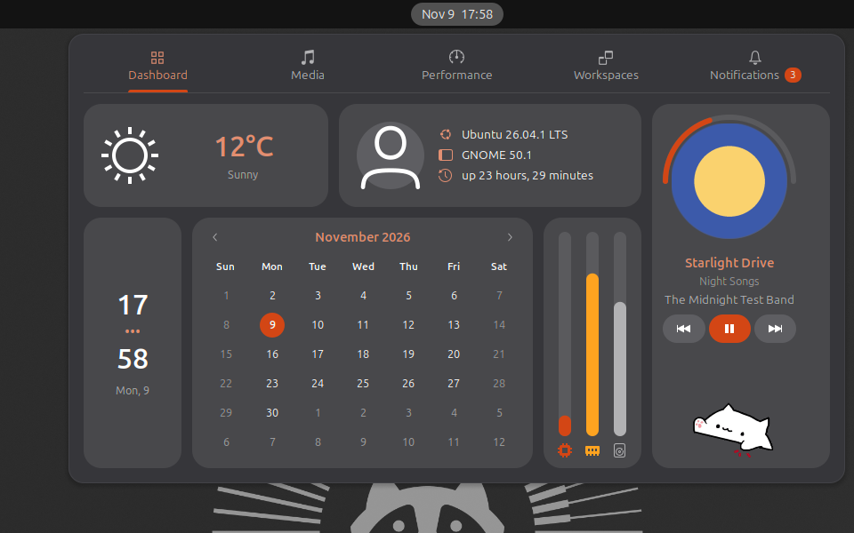

# Caelestia Dashboard for GNOME

A GNOME Shell extension that turns the clock's dropdown into the dashboard from
[Caelestia Shell](https://github.com/caelestia-dots/shell), in the colours of Yaru-dark's Quick Settings and your desktop's
accent colour.



Click the clock and it opens in GNOME's usual popup, with GNOME's own animation. It has five tabs:

- **Dashboard:** weather, your profile picture and system info, clock, calendar, CPU, memory and storage bars, and a media player with a progress arc and bongo cat
- **Media:** a larger player with the track time
- **Performance:** CPU with temperature, memory, storage, network and battery
- **Workspaces:** a card per workspace with its open apps; click one to go there
- **Notifications:** per-app cards with a count on the tab. Swipe sideways or middle-click a notification to dismiss it, and right-click to expand its card

## Requirements

GNOME Shell 50. It's tested on Ubuntu 26.04 with the Yaru-dark theme, and it uses GNOME Shell internals, so a major GNOME update may need a fix.

## Install

```bash
git clone https://github.com/cyborgcode/caelestia-dashboard-gnome.git ~/.local/share/gnome-shell/extensions/caelestia-dashboard@rayen.local
```

Log out and back in, because GNOME on Wayland only finds new extensions at login. Then enable it:

```bash
gnome-extensions enable caelestia-dashboard@rayen.local
```

## Good to know

- **Weather:** the card gets its reading from [wttr.in](https://wttr.in), which works out your location from your IP address and so sees that address.
- **Left out from Caelestia:** the Media tab has no lyrics or audio visualiser, and the Performance tab has no GPU card. Workspaces replaces Caelestia's current Weather tab.
- **Left out from GNOME:** calendar events and world clocks aren't in the dashboard.
- **Colours:** the dashboard uses Yaru-dark's Quick Settings colours, so it's made for that theme. Accents follow your desktop's accent colour.

## Credits

The design, the bongo cat and the dinosaur come from [Caelestia Shell](https://github.com/caelestia-dots/shell) by caelestia-dots. This is an independent GNOME port and isn't affiliated with that project.

## License

[GPL-3.0](LICENSE), the same as Caelestia Shell.
